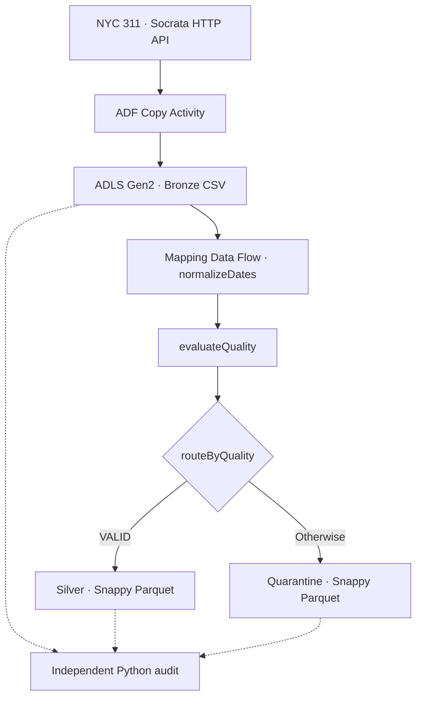

# CORTEX AION

**The data foundation for agentic intelligence.**

An Azure-native data engineering project that turns public operational records into validated, typed and traceable datasets for downstream analytics and future AI systems.

> **Status — v0.1 Data Foundations:** deployed and executed successfully on Azure; outputs independently audited on 26 November 2026. Agent-facing services are not implemented yet.

## Execution evidence

| Metric | Observed result |
|---|---:|
| Source records ingested | 5,000 |
| Silver records | 4,987 (99.74%) |
| Quarantine records | 13 (0.26%) |
| Missing / extra / duplicate identifiers | 0 / 0 / 0 |
| Bronze CSV / combined Parquet | 638,995 / 202,003 bytes |
| Storage reduction | 68.39% |
| Transformation activity duration | 4m 11s |
| Spark cluster startup | 2m 33s |

The 13 quarantined requests were marked Closed without a closing timestamp. Results are specific to one historical sample and one successful cloud execution; they are not a production-scale benchmark.

## Architecture

Two separately triggered pipelines decouple extraction from transformation. Bronze retains the nine selected source fields; the data flow adds three typed timestamps and one quality classification. Both output branches retain all 13 fields.

## Implemented capabilities

- HTTP extraction using a bounded, ordered Socrata query.
- Azure Data Factory Copy Activity and Spark-backed Mapping Data Flow.
- ADLS Gen2 storage with hierarchical namespace; private containers and managed-identity authentication for ADF.
- Explicit nine-column input projection; conversion of New York local timestamps to UTC.
- Five ordered quality checks and a default quarantine branch, preserving rejected records.
- Parquet with Snappy compression, GitHub-backed ADF definitions, and independent reconciliation of downloaded files.

## Repository

| Component | Location |
|---|---|
| Ingestion pipeline | [pl_nyc311_ingestion](azure/adf/pipeline/pl_nyc311_ingestion.json) |
| Transformation pipeline | [pl_nyc311_transformation](azure/adf/pipeline/pl_nyc311_transformation.json) |
| Mapping Data Flow | [df_nyc311_quality](azure/adf/dataflow/df_nyc311_quality.json) |
| Source and storage datasets | [azure/adf/dataset](azure/adf/dataset/) |
| Linked services | [azure/adf/linkedService](azure/adf/linkedService/) |
| Validation evidence and reproduction guide | [docs/v0.1-validation.md](docs/v0.1-validation.md) |
| Portable local validation script | [scripts/validate_outputs.py](scripts/validate_outputs.py) |

## Reproduce the milestone

1. Provision ADF V2 and an ADLS Gen2 account in a region allowed by your Azure subscription. Enable hierarchical namespace and create private bronze, silver and quarantine containers.
2. Configure the linked services for your storage account and the public NYC Open Data endpoint. Grant the factory managed identity appropriate blob data access. Use separate read-only data access for inspection.
3. Import the ADF definitions under `azure/adf/` using the collaboration branch, adapt environment-specific endpoints, validate and publish.
4. Trigger ingestion, verify the Bronze CSV, then trigger transformation once. Keep the data-flow debug cluster off when not needed.
5. Download Bronze and all Parquet output parts into separate local folders. Follow the [validation guide](docs/v0.1-validation.md).

Source: [NYC 311 Service Requests](https://data.cityofnewyork.us/resource/erm2-nwe9.json). The query filters January 2024, sorts by creation time and identifier, and limits the extract to 5,000 rows. The observed extract covers only part of 1 January 2024, not a representative month. The live source may change historical records, so exact reproduction requires the original snapshot.

## Engineering boundaries

This is a working academic cloud prototype, not a production data platform. Quality rules are deliberately limited; duplicate prevention, strict schema enforcement, incremental ingestion, run-isolated output paths and automated orchestration are not implemented. Repeated transformation runs may create additional output files. No claim is made that every flagged record is an actual source-system error, or that unflagged data is universally correct.

## Roadmap

| Milestone | Scope | Status |
|---|---|---|
| v0.1 · Data Foundations | Ingestion, typed transformation, quality routing, reconciliation | Implemented and audited |
| v0.2 · Data Platform | Incremental ingestion, idempotency, contracts, monitoring, deployment automation | Planned |
| v0.3 · Trusted Context | Provenance-aware retrieval, access control, agent-facing interfaces | Planned |
| v1.0 · Agentic Data Infrastructure | Evaluated integration with real agent workflows | Exploratory |

## Academic context

Developed for the UAX Master's in Big Data for Business. This milestone implements two Unit 2 practical exercises: **Copy Activity in a pipeline** and **Code-free data transformation at scale**. The individual academic PDF report is a separate deliverable.

No raw records, access keys or personal account identifiers are intentionally added by this documentation update. Review existing Azure exports and repository history before public release.

---
CORTEX AION · Data Foundations · November 2026
